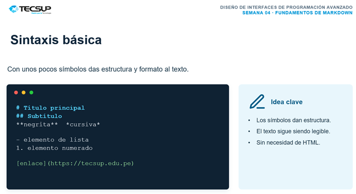

# Guía del proyecto

Esta guía explica cómo revisar y ejecutar el trabajo colaborativo del Laboratorio 03.

## Sobre el proyecto

El proyecto se desarrolló como parte del curso de Diseño de Interfaces de Programación Avanzado.

### Objetivo

Organizar el trabajo realizado y documentar los pasos principales para que otro estudiante pueda revisarlo.

## Archivos del proyecto

- `README.md`: contiene la presentación del proyecto.
- `docs/GUIA.md`: contiene esta guía.
- `img/captura.png`: contiene una captura del trabajo realizado.


## Pasos para revisar el proyecto

- [x] Crear el repositorio del proyecto.
- [x] Crear el archivo README.md.
- [ ] Completar la documentación de la guía.

## Herramientas utilizadas

| Herramienta | Uso |
|---|---|
| Git | Control de versiones |
| GitHub | Repositorio remoto |
| Visual Studio Code | Edición de archivos |


## Comandos básicos de Git

Para guardar los cambios del proyecto se utilizan estos comandos:

```bash
git add .
git commit -m "Actualiza la guia"
git push origin main
```

## Recurso de consulta

Puedes consultar la [guía oficial de Markdown](https://www.markdownguide.org/) para conocer más sobre su sintaxis.


## Captura del proyecto

La siguiente imagen muestra un ejemplo de sintaxis básica de Markdown.



